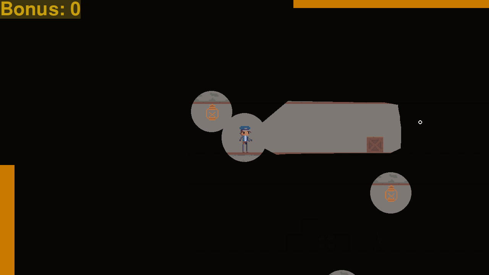
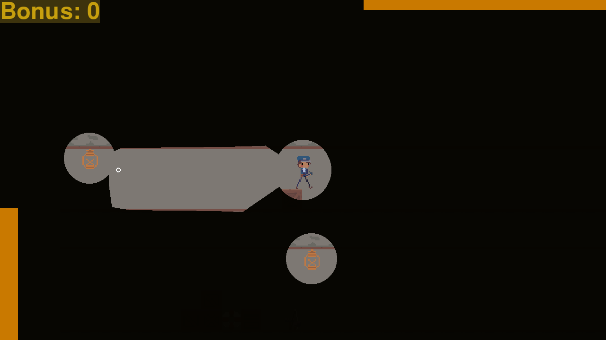
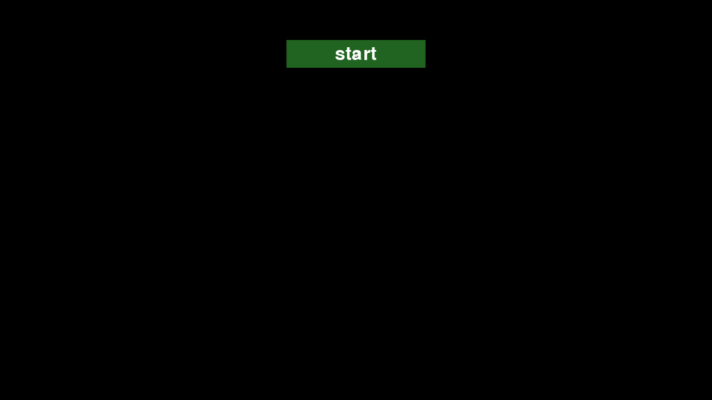

# pygame_proj

### Платформер, в котором свет показывает путь

Исследуйте тайловый уровень с фонарём, собирайте бонусы и доберитесь до финиша.
Поворот фонаря следует за мышью, стены ограничивают свет, а лампы освещают
отдельные участки карты. Здоровье, выносливость и результаты попыток делают
прохождение частью игрового цикла.

**Версия 0.1.0 · Статус: игровой прототип.** Карты, спрайты и исходники находятся в репозитории;
внешние сервисы и API-ключи для игры не требуются.

[Скриншоты](#скриншоты) · [Быстрый запуск](#быстрый-запуск) ·
[Управление](#управление) · [Компоненты](#компоненты) · [Проверка](#проверка)



*Фонарь раскрывает участок коридора впереди, а лампы отмечают отдельные зоны карты.*

## Что реализовано

| Возможность | Как это работает |
|---|---|
| Свет и исследование | Фонарь следует за мышью, лучи встречают стены; лампы освещают свои участки |
| Передвижение | Ходьба, прыжок, ускорение с расходом выносливости и лестницы |
| Тайловый мир | Карта Tiled, камера за игроком и отрисовка видимых чанков |
| Игровые цели | Бонусы, опасные клетки, здоровье и финиш |
| Повторные попытки | Стартовый экран, результаты, экран смерти и перезапуск уровня |
| Локальная статистика | SQLite сохраняет число бонусов и время попытки |

## Скриншоты

| Прыжок и смена направления света | Стартовый экран |
|---|---|
|  |  |
| Камера следует за героем; фонарь можно повернуть независимо от движения. | При первом запуске статистика ещё пуста. Кнопка `start` открывает уровень. |

Все три изображения — настоящие кадры локального запуска `main.py` при разрешении
**1280 × 720**. Движение, прыжок и положение мыши задавались управляемым вводом;
использовались штатные карта, спрайты и отрисовка игры. Галерея показывает прототип
версии **0.1.0**.

## Быстрый запуск

Нужен Python и две библиотеки: **pygame** и **PyTMX**. Для повторения проверенной
среды использовались Python **3.11.7 x64**, pygame **2.6.1** и PyTMX **3.32** на
Windows. В командах ниже `python` должен указывать на Python 3.11. Другие
операционные системы не проверены; перед установкой убедитесь, что выбранный
Python поддерживается пакетами.

```powershell
git clone --branch raycast-f https://github.com/MrRodikolion/pygame_proj.git
cd pygame_proj
python -m venv .venv
.\.venv\Scripts\python.exe -m pip install pygame==2.6.1 pytmx==3.32
.\.venv\Scripts\python.exe main.py
```

На Linux/macOS путь к интерпретатору виртуального окружения — `.venv/bin/python`.
Ресурсы ищутся относительно исходников, поэтому `main.py` можно запускать и по
абсолютному пути из другого каталога. SQLite входит в стандартную библиотеку
Python; файл `stats.db` создаётся рядом с `main.py` и не включается в Git.

> В репозитории также есть исторический `main.exe`. Приведённые инструкции и
> результаты проверки относятся к исходникам Python; существующий `.exe` не
> пересобирался и может отличаться от них.

## Управление

| Действие | Клавиша / ввод |
|---|---|
| Движение влево / вправо | `A` / `D` |
| Подъём / спуск по лестнице | `W` / `S` |
| Прыжок | `Space` |
| Ускорение с расходом выносливости | Левый `Shift` |
| Направление фонаря | Мышь |
| Кнопки меню | Левая кнопка мыши |
| Переключение полноэкранного режима | `F` |
| Выход | `Esc` или закрытие окна |

## Компоненты

| Путь | Ответственность |
|---|---|
| [`main.py`](main.py) | Экраны игры, игровой цикл, SQLite-статистика |
| [`game_components/Map.py`](game_components/Map.py) | Загрузка TMX, чанки, камера, коллизии и освещение |
| [`game_components/Player.py`](game_components/Player.py) | Движение, прыжки, анимация, взаимодействия и фонарь |
| [`game_components/UI.py`](game_components/UI.py) | Кнопки, здоровье, выносливость и счётчик бонусов |
| [`data/map/`](data/map/) | Карты Tiled и набор тайлов |
| [`data/player/`](data/player/) | Спрайты игрока |

Основной игровой цикл загружает `data/map/level1.tmx`. В каталоге карт также
сохранены `level0.tmx` и `test.tmx`; выбора уровня в меню пока нет.

## Проверка

Проверка синтаксиса из корня проекта:

```powershell
.\.venv\Scripts\python.exe -m compileall -q main.py game_components
```

Собственного автоматического набора тестов в репозитории пока нет. При изменении
игровой логики вручную проверьте запуск, вход в уровень, движение у нескольких
препятствий, лестницы, бонусы, лампы, финиш, смерть и повторную попытку.
После завершённой попытки проверьте статистику при следующем запуске.

При аудите 8 ноября 2026 года отдельные внешние регрессионные проверки подтвердили
типы коллизий и лампы на карте с пустыми клетками, сохранение этого соответствия
при движении камеры, выбор ближайшего бокового препятствия и загрузку ресурсов
из другого рабочего каталога. Всего прошли **13 проверок**, включая управляемый
ввод движения / ускорения / прыжка, опасные клетки, финиш, смерть при нулевом
здоровье, оба пути повторной попытки и по одной SQLite-записи на попытку.
Переходы проверялись на настоящих экранах с подменой ввода и состояния игрока.
Реальная точка входа также прошла меню и 120 кадров игры с настоящими картой и
спрайтами в SDL-режиме без окна. Это проверка выполнения кода, а не подтверждение
полного прохождения или работы полноэкранного режима.

## Ограничения и дальнейшая работа

- [ ] Добавить постоянные автоматические регрессии игрового цикла и карт.
- [ ] Проверить полный маршрут до финиша и баланс здоровья / выносливости.
- [ ] Проверить полноэкранный режим и обычный ввод на разных системах.
- [ ] Добавить выбор существующих уровней и настройки управления.
- [ ] Подготовить воспроизводимую сборку исполняемого файла.

Пока игра остаётся прототипом: успешный запуск отдельных кадров не означает
завершённую проверку всех игровых состояний.
